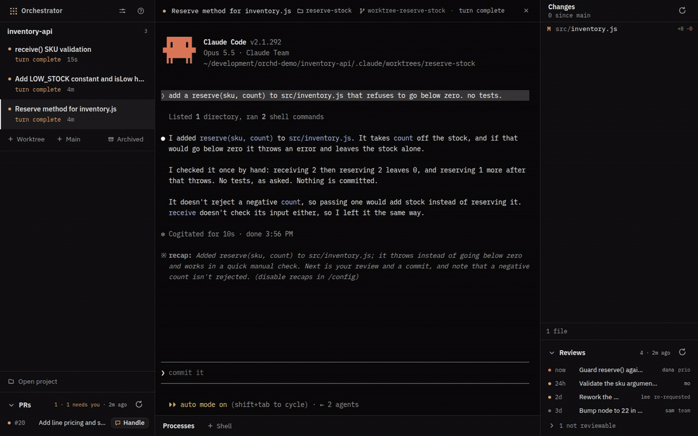
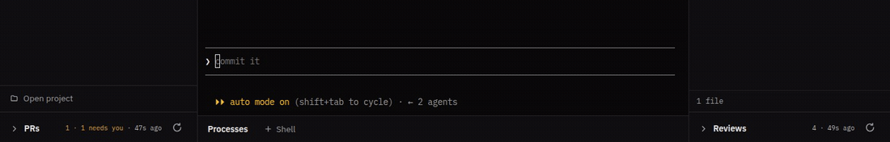
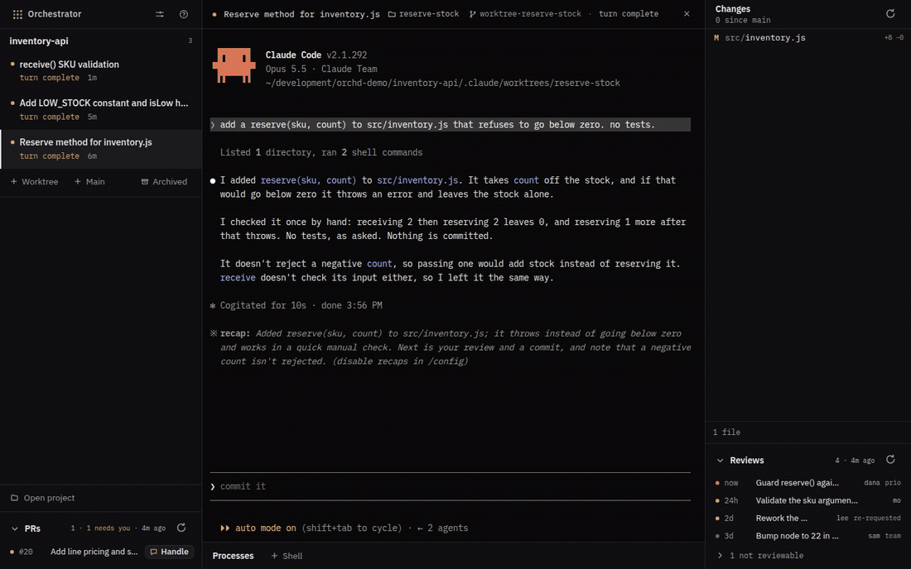
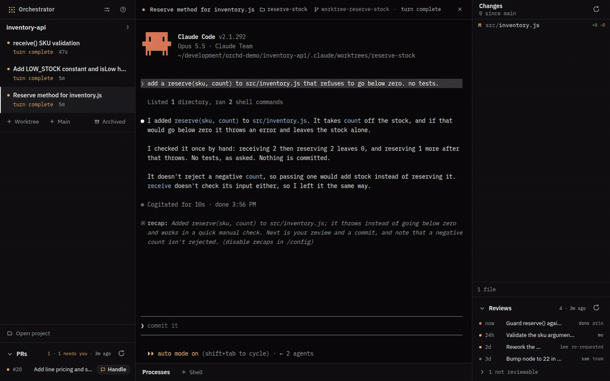
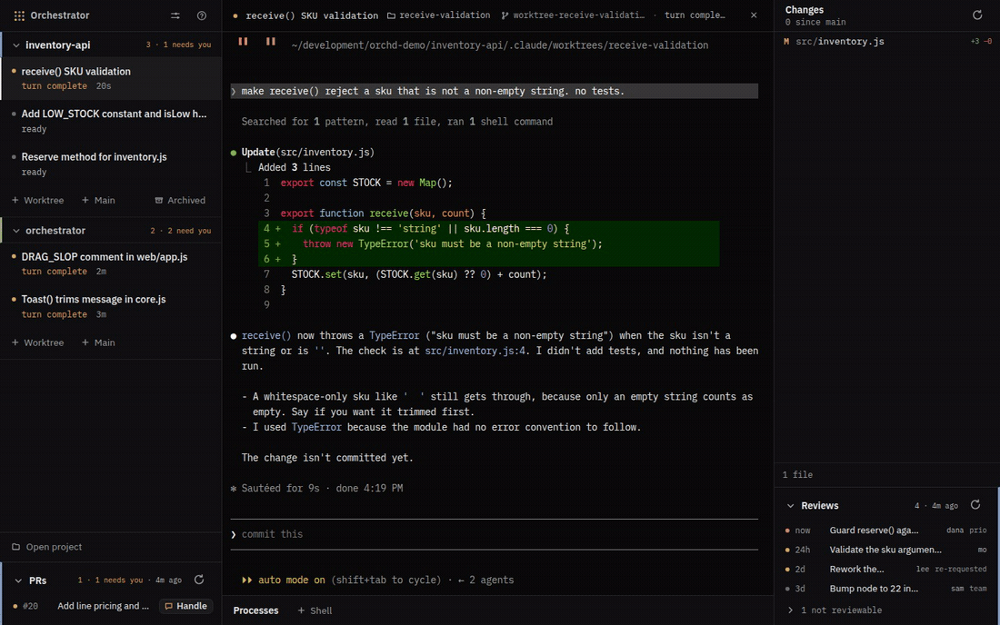
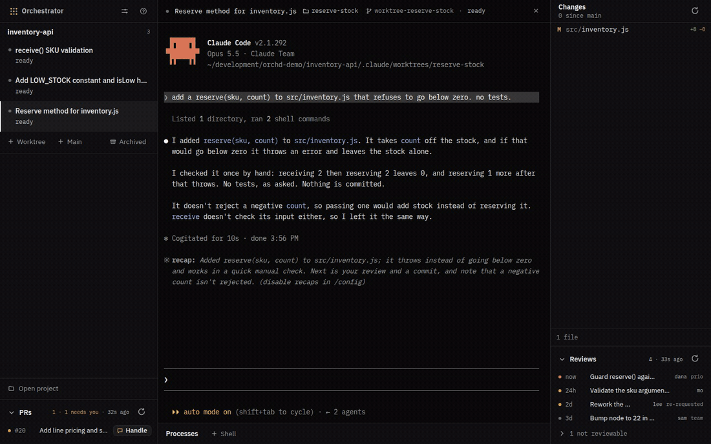
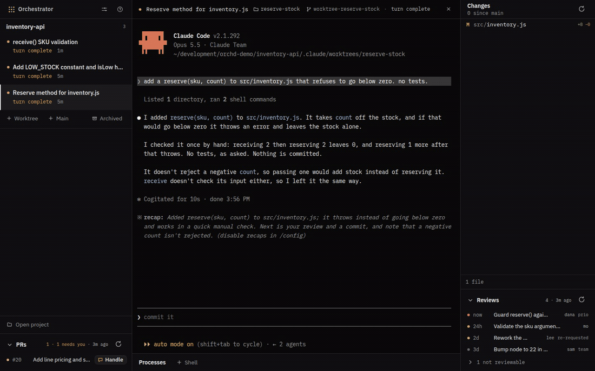
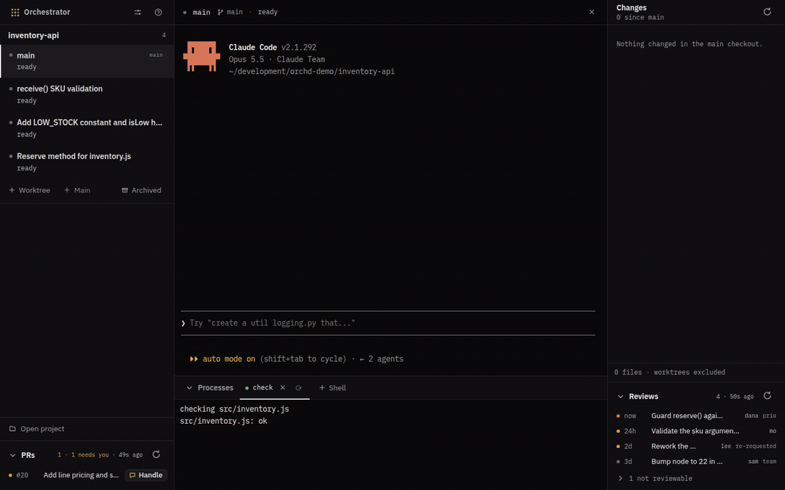

<picture>
  <source media="(prefers-color-scheme: dark)" srcset="docs/logo-dark.svg">
  
</picture>

# orchestrator

**An agentic development environment (ADE), from prompt to commit to PR to review.**
Every session gets its own worktree and terminal, and keeps running when you close
the app. When checks fail, one press has an agent fix them, push, and watch CI
until the PR is green. When review comments arrive, another press hands them to an
agent. It fixes what is clear, asks you where a decision is needed, and drafts
every reply for your go.

[](https://github.com/kbarendrecht/orchestrator/releases/latest)
[](https://github.com/kbarendrecht/orchestrator/actions/workflows/check.yml)
[](LICENSE)




A Rust daemon and a small vanilla-JS web app, shipped as one desktop application
and runnable headless in a browser tab. It hosts
[Claude Code](https://www.anthropic.com/claude-code) and
[Codex](https://developers.openai.com/codex/cli/) sessions, several checkouts in
one window. It is not itself an agent.

[What it does](#what-it-does) · [The review loop](#the-review-loop) ·
[Install](#install) · [The agents](#the-agents) · [What you need](#what-you-need) ·
[Security](#security) · [Developing](#developing)

## What it does

Each row is real: the agents are the ones you run, the diffs are what they wrote.
[`docs/demo.md`](docs/demo.md) says how the recordings are made.

<table>
<tr>
<td><b>01 &middot; The PR pane and the review queue &mdash; see who is waiting on whom.</b> Your open PRs, each with the threads still owed a reply and the checks that are red. Below them, other people's PRs ranked by how long somebody has waited: a request to you by name is amber, a request to your team is grey, and draft, conflicting and failing rows sink below a fold. The queue rows are demo data &mdash; <a href="docs/demo.md">why</a>.</td>
<td></td>
</tr>
<tr>
<td><b>02 &middot; Skills &mdash; one press hands the PR to an agent.</b> The skills ship with the app and reach every session. <code>handle</code> on a PR row starts <code>handle-review</code>: one agent reads the threads, applies what is right, asks you about the rest, and drafts the replies. <code>fix</code> starts <code>fix-pr</code>, which takes a red PR green and never comments. <a href="#the-review-loop">What each one refuses</a> is the half worth reading.</td>
<td></td>
</tr>
<tr>
<td><b>03 &middot; Git aware &mdash; see what changed before you answer for it.</b> Two panes watch the working tree: changed files with git's own verbs, and a word-level diff against the merge-base that you can edit in.</td>
<td></td>
</tr>
<tr>
<td><b>04 &middot; Sessions &mdash; several projects, several agents, and nothing dies with the window.</b> Open more than one checkout in the same window; the panes follow the row you click. Each session gets its own git worktree and its own terminal. The daemon owns every pty, so closing the window loses nothing.</td>
<td></td>
</tr>
<tr>
<td><b>05 &middot; Read and edit &mdash; find it, open it, change it.</b> Search a workspace with ripgrep's engine, and open a hit in its own file pane. Modifier-click a path or a symbol to go there. The pane is editable, and the agent is told when you change a file under it.</td>
<td></td>
</tr>
<tr>
<td><b>06 &middot; Processes &mdash; a terminal and a build watcher, beside the agents.</b> <code>+</code> in the drawer opens a shell in the workspace. Declared processes &mdash; a build watcher, a container stack &mdash; run beside it, and their health folds into the rail next to the session that broke it.</td>
<td></td>
</tr>
</table>

## The review loop

This is what the app is for. A PR row carries the verb that its state calls for,
and pressing it starts an agent in that PR's worktree:

- **`handle`** — threads are waiting. `handle-review` runs in a pane you watch and
  can take over: it judges each thread, applies what is right, asks you about the
  rest with a blocking question, and drafts the replies.
- **`fix`** — the checks are red. `fix-pr` takes the base branch in, fixes the red,
  amends, pushes and watches CI until it settles.
- **Where a session already holds the branch**, the press hands the job to that
  session as a typed turn rather than starting a second one.

While a run is live the row reads `handling` or `fixing`, and pressing that takes
you to the session doing it.

**Nothing goes out without a separate go.** That rule is in each skill rather than
in a setting, so it holds whichever agent runs it:

| Skill | What it does | What it will not do |
| --- | --- | --- |
| `handle-review` | works a PR's threads in a pane, drafts each reply, and files a story for a fair point that is out of scope | post anything without an explicit go; resolve a thread |
| `fix-pr` | takes a red PR green: base in, fix, amend, push, watch CI | comment, re-request a review, open or merge a PR |
| `orch` | reaches the daemon from inside a session: ask a blocking question, start a second session, list what is running before touching a branch | reach GitHub; the daemon's own guard decides the rest |

**Marking a thread resolved stays your button, by design.** The agent answers; the
reviewer decides the answer was enough.

## Install

```
brew install --cask kbarendrecht/tap/orchestrator   # macOS, Apple Silicon
mise use -g github:kbarendrecht/orchestrator        # anywhere
```

On Debian and Ubuntu, from the apt repository:

```
curl -fsSL https://kbarendrecht.github.io/apt/orchestrator.asc \
  | sudo tee /usr/share/keyrings/orchestrator.asc > /dev/null
echo "deb [arch=amd64 signed-by=/usr/share/keyrings/orchestrator.asc] https://kbarendrecht.github.io/apt stable main" \
  | sudo tee /etc/apt/sources.list.d/orchestrator.list > /dev/null
sudo apt update && sudo apt install orchestrator
```

Each of those installs the app, the `orchd` daemon it runs per checkout, and the
`orch` CLI. The
[release page](https://github.com/kbarendrecht/orchestrator/releases/latest) also
attaches a `.dmg`, a `.deb` and a tarball. Apple Silicon and x86-64 Linux are
built.

**All three upgrade from inside the app.** When a release lands, the bar at the
top carries an Upgrade button that runs your own channel's command — `mise
upgrade`, `brew upgrade --cask`, or apt behind a password prompt — and then a
Restart button, because the running process is the old build until it goes. A
downloaded `.dmg` or tarball gets the release link instead.

State lives in `~/.config/orchd/` on Linux and `~/Library/Application
Support/orchd/` on macOS — move it with `ORCHD_CONFIG_DIR`. Every setting is in the
settings panel, and [`docs/configuration.md`](docs/configuration.md) lists each one
with its default.

## The agents

**Either agent is enough.** The board offers what it finds on `PATH`, and `+`
starts the one `default_agent` names — or the one you picked last. The rail, the
worktrees, the diff and PR panes, and the resume after a restart are the same for
both. These five things are not:

| | Claude Code | Codex |
| --- | --- | --- |
| The conversation's id | the daemon's, handed over with `--session-id` | Codex's own, learned from its first hook |
| The skills | a plugin dir, called as `/orchd:fix-pr` | named in `developer_instructions`, called as `orchd:fix-pr` |
| The hooks | a settings file that merges with your repo's | `-c` overrides per invocation, each trusted by hash |
| Rewind | offered in the row's menu | not offered: two escapes mean whatever Codex makes of them |
| Workspace trust | accepted once per checkout, or sessions die on spawn | nothing to accept |

[`docs/assumptions.md`](docs/assumptions.md) has what each agent was measured
doing, and what breaks when it stops.

## What you need

| What | Why |
| --- | --- |
| **Claude Code** or **Codex** (`claude` or `codex` on `PATH`, signed in) | The daemon spawns one for every session. With neither, a session exits the instant it starts, so the daemon says so at boot rather than letting you find out that way. |
| **git 2.23 or newer** | Worktrees, branch moves, diffs — all of it. 2.23 is `switch`/`restore`, the oldest thing the daemon spells. One repo setting needs more: `core.fsmonitor` is a boolean from 2.37 and a *hook path* before it, so on an older git the daemon leaves it alone. |
| **WebKitGTK 4.1** (Linux only) | The desktop window. Ubuntu 22.04 / Debian 12 or newer; 20.04 ships 4.0 and will not work. macOS uses the system WebView. |
| **`gh`**, signed in | The review skills post through the agent's own `gh`. The daemon only reads, with `curl`, and takes its token from `gh auth token` unless `github_token_file` or `ORCHD_GITHUB_TOKEN` is set. |

A fresh checkout also needs Claude Code's **workspace trust**, accepted once in
its dialog. Until then its sessions die on spawn.

Nothing here is checked at install time. The daemon checks at **boot**, names what
is missing and what stops working, and starts anyway.

## Security

Bound to `127.0.0.1`, with Origin and Host validation and a per-start token on the
WebSocket and every mutating route. GitHub reads use `ORCHD_GITHUB_TOKEN`, a
`0600` `github_token_file` or `gh auth token`. The daemon writes nothing to
GitHub: a reply is the agent's, through its own `gh`.

**The trust boundary is your user account, not the process.** `GET /` hands out
the token, so any process running as you can hold everything, including a live
agent's terminal. Do not run this on a machine you share with people you do not
trust.

Agents get narrower credentials than the page does, and a `PreToolUse` guard
refuses three things on the agent's git: a lease-less force push, a push that
writes the base branch or removes branches, and git that changes main or another
worktree the app manages. Read it as a mistake-catcher, not a control — it sees
`Bash` calls only.

[`docs/security.md`](docs/security.md) has the reasoning behind each of those, and
what each one does not cover.

## Troubleshooting

[`docs/troubleshooting.md`](docs/troubleshooting.md) names each symptom and what
it means. The three most common:

- **Every Claude Code session dies the instant it starts.** Workspace trust has
  not been accepted for that checkout. Accept it in the dialog once.
- **A setting does nothing.** An unknown key is ignored, and the daemon names it
  at start-up in `orchd.log`.
- **Started from the launcher, it cannot find `gh`, `claude` or `codex`.** A
  launcher does not hand the app your shell's `PATH`.

## Developing

```
mise install
mise run deps                            # tools/node_modules; every task that
                                         # needs it depends on this already
git config core.hooksPath .githooks      # once per clone
git config blame.ignoreRevsFile .git-blame-ignore-revs   # once per clone
cargo test --workspace                   # the four crates
mise run check-web                       # type-check and lint the SPA + its graph
cargo run -p orchestrator-desktop        # the app: it hosts the page and spawns
                                         # one orchd per checkout
mise run shot                            # screenshot the running app (drives Chrome)
mise run fixture                         # a throwaway PR to drive the review flow
```

`cargo run -p orchd-serve --bin orchd -- --main /path/to/your/repo` runs one daemon
headless and prints a tokened URL. `mise run shot` drives Chrome while the app runs
in **WebKitGTK**, so it is good for layout and not the last word.

| Where | What is in it |
| --- | --- |
| [`docs/architecture.md`](docs/architecture.md) | how the running system fits together, and the module map |
| [`CLAUDE.md`](CLAUDE.md) | the traps, one line each |
| [`docs/traps/`](docs/traps/gates.md) | what each trap cost |
| [`docs/assumptions.md`](docs/assumptions.md) | what the daemon assumes, and what breaks when each is false |
| [`docs/spec.md`](docs/spec.md) | the requirements the `(§N)` comments point at |
| [`TODO.md`](TODO.md) | what is open |

Releases are CalVer (`year.month.n`), and `mise run release` cuts one: it bumps
the version, **waits for `check` to go green on the commit you are on**, then
commits, tags and pushes. The waiting is the point — `check` is the only thing
that runs the suite on macOS, and a tag pushed before it answers may publish
nothing.

## Licence

Copyright © 2026 Kars Barendrecht.

[AGPL-3.0-only](LICENSE). Use it, run it, change it. If you distribute it, or run
a modified version as a network service, the source has to go with it under the
same terms. In the desktop app that network clause does nothing — the daemon binds
loopback and you are both the operator and the user. It has teeth in the
**headless** mode, which binds a port and prints a URL, and it is what keeps a
hosted variant open.

The vendored web assets are not ours: xterm.js, PrismJS and four font families,
all MIT or OFL-1.1. [`THIRD-PARTY.md`](THIRD-PARTY.md) lists each one with its
version and the notice its licence asks to travel with it.
